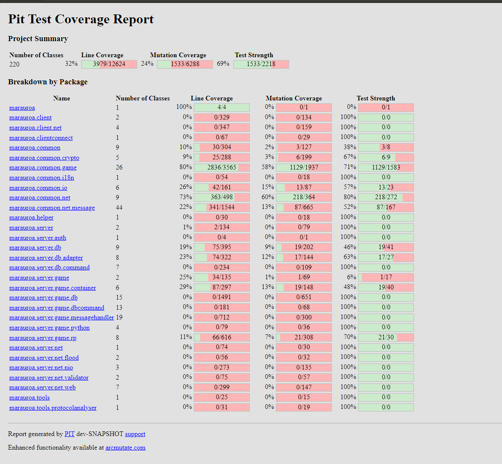

# Group Analysis and Results
## Identification of the open-source project.
We are testing the [Maraurora](https://arianne-project.org/engine/marauroa.html) project. It is a multiplayer engine written in Java using a TCP oriented network protocol and an SQL based persistence engine. The project spans 26,000 lines of code and builds in 5 seconds from source code using `ant`. 
## Test suite infrastructure
Maraurora uses `JUnit` for its suite of 143 tests, across 2648 lines of code and takes 7 seconds to execute on a dry run, 4 seconds on subsequent runs.
## Results

| Metric | Numerator / denominator | Result |
|---|---|---|
| Line coverage | 3979 / 12624 | **32%** |
| Mutation score (killed + timeout) | 1533 / 6288 | **24%** |

## The output coverage reports that provide clear evidence of usage

## How do your results from PIT and Stryker compare?
TODO
## What do the results tell you about your test suite?
**DRAFT**

The report shows that the most tested aspects of the project are `marauora.common.[game\net]` because they have the most amount of coverage.
## Which system did you find easier to use (both integrate and interpret) and why?
(melody) Stryker, setup is confined within the project. It doesn't need additional dependencies on the machine unlike with PIT where you need OpenJDK etc. Stryker is project specific
## Do the test suites exhibit weaknesses? How can they be improved?
The overall PIT report shows 32% line coverage and a 24% mutation score, so many paths are either untested or insufficiently checked. The database package's separate report located in `mutation-results-db/index.html` is somewhat better at 46% line coverage, but its mutation score is only 22% (141 of 651 mutants), indicating that many behavioral changes still go undetected. The networking results are also uneven. Although `marauroa.common.net` has 73% line coverage and a 58% mutation score, the client and server network packages have 0% line and mutation coverage in the main report.

These gaps could be improved by adding deterministic database integration tests such as tests to verify persistence, transaction, and error-handling behavior. For networking, it could be improved by adding focused tests for client/server connection lifecycles, timeouts, disconnects, malformed input etc. Across both areas, the improved tests should assert observable outcomes rather than only execute code.
## Do the test suites exhibit strengths? How do you recognize them?
The strengths of the test suite can be seen in `marauroa.common.game` with 80% line coverage, 58% mutation coverage and a test strength of 71%. Its 58% mutation coverage also shows that the tests detect many meaningful behavioral changes. Another strong area is a part of the network code in `marauroa.common.net`, with 73% line coverage, 60% mutation score, and 80% test strength. In its class breakdown, `Encoder` and `EncoderDecoderTest` each show 100% line and mutation coverage, suggesting the encoder behavior and its tested round-trip cases are checked thoroughly. 

These strengths are easy to recognize with the strong amount of coverage by the tests conducted, compared to the rest of the test coverage report, where most of the line and mutation coverage is at 0%.
## Contrast the costs and benefits of mutation analysis and testing versus what you might expect from other techniques.
**Costs**: Mutation testing with PIT took about 1 minute 10 seconds for the run excluding the database tests and 88 seconds for the run including the database and connection tests. This is more time than a normal test run ex. `ant test` because PIT repeatedly modifies the program and runs tests against those modified versions. The reports also take time to interpret as surviving mutants need reviewing since they can indicate missing assertions and also be equivalent to the original code.

**Benefits**: Mutation testing provides more insight as it reveals whether tests detect small behavioral changes as compared to line coverage which only shows whether some code ran. Additionally, compared with a regular JUnit run, PIT helps identify tests that pass without checking outcomes effectively. Its results also help prioritize areas for improvement such as showing stronger coverage in marauroa.common.game from other weaker less tested areas. 
## What was easy and what was difficult about applying the tools to the projects you chose?
The easy part was compiling and testing the project once we got PIT setup. The hard part was getting PIT to work on our machines. Since Marauora uses `ant` to build, we had to get the correct `pitest` jars from the GitHub repo. Which meant we needed to compile `pittest` itself and move the jars to the `libs/` directory in Marauora. Then we had to downgrade some libraries used by Marauora after reading all the error logs. We also encountered issues where the build for PIT testing would fail since we didn't have a compatible environment for it and it was difficult to locate the root cause. We had to go through different possibilities on what might be failing such as looking into incompatible Java versions or missing packages such as OpenJDK since the build failure messages were hard to interpret with the sheer amount of information printed out.
## What obstacles did you face in applying mutation analysis to a real world project, and how did you overcome them?
We encountered compatibility issues because the project used an older JUnit version than the one expected by our PIT setup. Additionally, some database tests also failed under PIT even though the regular test run worked. We discovered that the tests share a static singleton state, including `TransactionPool` and `DAORegister`, and PIT can run tests in a different order or rerun them while analyzing mutants. This shared state made the database tests sensitive to execution order. To work around this, we had to create a separate PIT target for the database tests and generated a dedicated report for them.
## Did you have any other interesting insights or opinions on the experience?
Each of us can say whatever ig. <br>
IMO (Viktor) it was interesting running the tests on this project which is an online game server, so as a user I wouldn't suspect how many interactions between components make the multiplayer game run. The fact that the mutation coverage is low may be a sign that the tests haven't been updated too often or they didn't take this approach into consideration when they were writing them.
**We should add our raw opinion first and then make it sound "academic" later**
(melody) it was interesting to see just how weak the test coverage for smaller areas of the program is with what looks like half being 0% line and mutation coverage. even though the main areas are well tested, it would definitely help with having some deterministic tests on networking and database as they are still an important area of the project overall

# Individual Analysis and Results
Choose a complex routine that you think is likely to have errors. If fewer than 10 mutants were generated for the method, then either select a different method or select additional methods until you have 10 mutants to consider.

Examine 10 of the generated mutants for your method(s). If both killed and unkilled mutants were generated, include a mix of both. For each one, document your mutation operator. What was the type of operator used? How was it applied to the code (how did the code change)?

For your individual mutants consider the following additional questions: 
- How many mutants are killed?
- How many mutants are live? 
- For every mutant that was not killed, try to determine either 
    - (a) that it is an equivalent mutant that should not be killed
    - (b) how to add a test to kill it. 

Note that (b) involves a test case for a function with inputs and an oracle. Ideally, it is even written in the same testing framework as the project. 

For all mutants, try to determine whether they are duplicates of each other. 
- What are the challenges involved?
- Does it affect the results?
- Calculate and report the mutation score / effectiveness for your particular mutants. 

What do these results say about the effectiveness of the test suite and the method(s) that you considered?

## Oliver Analysis
TODO
## Melody Analysis
### Project: [Focu](https://github.com/mellli1231/mma_game)

**Method chosen:** `src/engine/ai.ts::chooseEnemyAction` **analysed with Stryker**

**Original line:** 

`if (!enemy || enemy.hp <= 0) throw new Error('Enemy active Lockling is not able to act.');`

**Mutant 1:** 

`if (true) throw new Error('Enemy active Lockling is not able to act.');`
- BooleanOperator
- Change: `if (!enemy || enemy.hp <= 0)` &rarr; `if (true)`
- Killed

**Mutant 2:**

 `if (!enemy && enemy.hp <= 0) throw new Error('Enemy active Lockling is not able to act.');`
- LogicalOperator
- Change: `||` &rarr; `&&`
- Survived

**Mutant 3:** 

`if (!enemy || enemy.hp < 0) throw new Error('Enemy active Lockling is not able to act.');`
- EqualityOperator
- Change: `<=` &rarr; `<`
- Survived

**Original line:**

`.filter(({ creature }) => creature.hp > 0 && creature.hp / MAX_HP <= AI_HEAL_THRESHOLD)`

**Mutant 4:** 

`.filter(({ creature }) => creature.hp > 0 && creature.hp * MAX_HP <= AI_HEAL_THRESHOLD)`
- ArithmeticOperator
- Change: `/` &rarr; `*`
- Killed

**Mutant 5:** 

`.filter(() => undefined)`
- ArrowFunction
- Change: `({ creature }) => creature.hp > 0 && creature.hp / MAX_HP <= AI_HEAL_THRESHOLD` &rarr; `() => undefined`
- Killed

**Mutant 6:** 

`.filter(({ creature }) => creature.hp <= 0 && creature.hp / MAX_HP <= AI_HEAL_THRESHOLD)`
- EqualityOperator
- Change: `>` &rarr; `<=`
- Killed

**Original line:**


`const bestHeal = heals.reduce((best, current) => current.move!.power > best.move!.power ? current : best);`

**Mutant 7:** 

`const bestHeal = heals.reduce(() => undefined);`
- ArrowFunction
- Change: `(best, current) => current.move!.power > best.move!.power ? current : best` &rarr; `() => undefined`
- Survived

**Original line:**

`if (rng() < gym.aiBestMoveChance) `

**Mutant 8:** 

`if (false) `
- ConditionalExpression
- Change: `rng() < gym.aiBestMoveChance` &rarr; `false`
- Killed

**Mutant 9:** 

`if (rng() >= gym.aiBestMoveChance) `
- EqualityOperator
- Change: `<` &rarr; `>=`
- Killed

**Mutant 10:**  

`if (rng() < gym.aiBestMoveChance) {}`
- BlockStatement
- Change:  `if {body}` &rarr; `if {}`
- Killed

### How many mutants killed? How many mutants are live?
Out of the 10 chosen, 7 were killed and 3 survived.

### For every mutant that was not killed, determine either (a) that it is an equivalent mutant that should not be killed, or (b) how to add a test to kill it
None of the surviving mutants are equivalent mutants, so a test case will be added to kill them. 

To kill mutant 2 and 3

```
it('reject an active enemy at zero HP', () => {
  const battle = createBattle(stateFor('embrit'), 5, false);
  const activeIndex = battle.enemy.activeIndex;
  const deadEnemy: BattleState = {
    ...battle,
    enemy: {
      ...battle.enemy,
      team: battle.enemy.team.map((creature, index) =>
        index === activeIndex ? { ...creature, hp: 0 } : creature,
      ),
    },
  };

  expect(() => chooseEnemyAction(deadEnemy, GYMS[5]!, () => 0))
    .toThrow('Enemy active Lockling is not able to act.');
});
```
Since mutant 2 and mutant 3 have a very similar issue of failing to reject an enemy when it is at exactly 0 HP, then this test is able to kill both of them. The test case targets the zero HP edge case and asserts that chooseEnemyAction throws the expected error when a new battle is created and the enemy spawns at 0 HP. The original condition rejects an enemy with 0 HP, while both mutants allow it, so the test will be able to kill both mutants.

To kill mutant 7

```
it('chooses the stronger of multiple available heals', () => {
  const battle = createBattle(stateFor('embrit'), 5, false);
  const enemy = battle.enemy.team[0]!;
  const configured: BattleState = {
    ...battle,
    enemy: {
      ...battle.enemy,
      team: [
        {
          ...enemy,
          moveIds: ['fire_blaze_burst', 'fire_kindle', 'fire_phoenix_rest'],
          healUsesLeft: { fire_kindle: 2, fire_phoenix_rest: 2 },
        },
        { ...battle.enemy.team[1]!, hp: 35 },
        { ...battle.enemy.team[2]!, hp: 10 },
      ],
    },
  };

  expect(chooseEnemyAction(configured, GYMS[5]!, () => 0.99)).toEqual({
    kind: 'move',
    moveId: 'fire_phoenix_rest',
    targetIndex: 2,
  });
});
```
Mutant 7 survived because the existing AI tests provide only one eligible heal, and a reducer does not call its callback when there is just one item. This test case provides multiple eligible heals and checks that the AI selects the strongest one. This test input requires the reducer to compare candidates, so then the mutant will behave differently from the original program and be killed.

### For all mutants, try to determine whether they are duplicates of each other. What are the challenges involved? Does it affect the results?

None of them are duplicates of each other since most mutate different expressions or apply different replacements. Some have overlapping effects like mutants 2 and 3 both allow an active enemy at exactly 0 HP, so the same test can kill both. That doesn't make them equivalent since their behavior can differ on other inputs.

The challenge is that equivalence requires an attention to detail and more consideration than expected in order to identify, matching behavior doesn't prove that two mutants are equivalent for all valid inputs.

With the current set of mutants it doesn't affect the results since no duplicates were found and each mutant can be counted. However, if it were the case that duplicates were found, then that would affect the result and we would need to remove the duplicates when calucating the final mutation score.

### Calculate and report the mutation score / effectiveness for your particular mutants. What do these results say about the effectiveness of the test suite and the method(s) that you considered?

For the ten selected mutants, there were no duplicate mutants so the mutation score is:

 7 / 10 &rarr; 70%

The score suggests the tests cover several important chooseEnemyAction branches, but there are still areas to improve on. The existing test suite doesn't completely test all the gaps in the method, such as the boundary conditions and in less common scenarios. The tests didn't distinguish zero HP from negative HP, didn't exercise selection among multiple heals, and didn't make the random attack differ from the best attack. Adding those cases would improve the test suite and the mutation score.

## Viktor Analysis
TODO